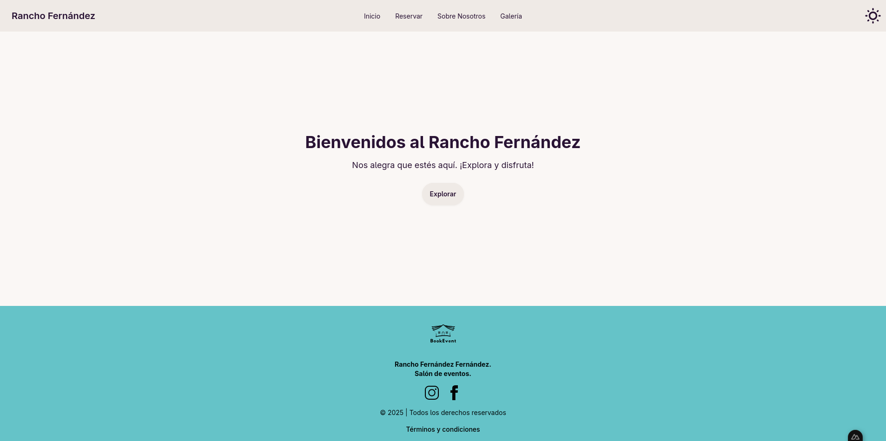
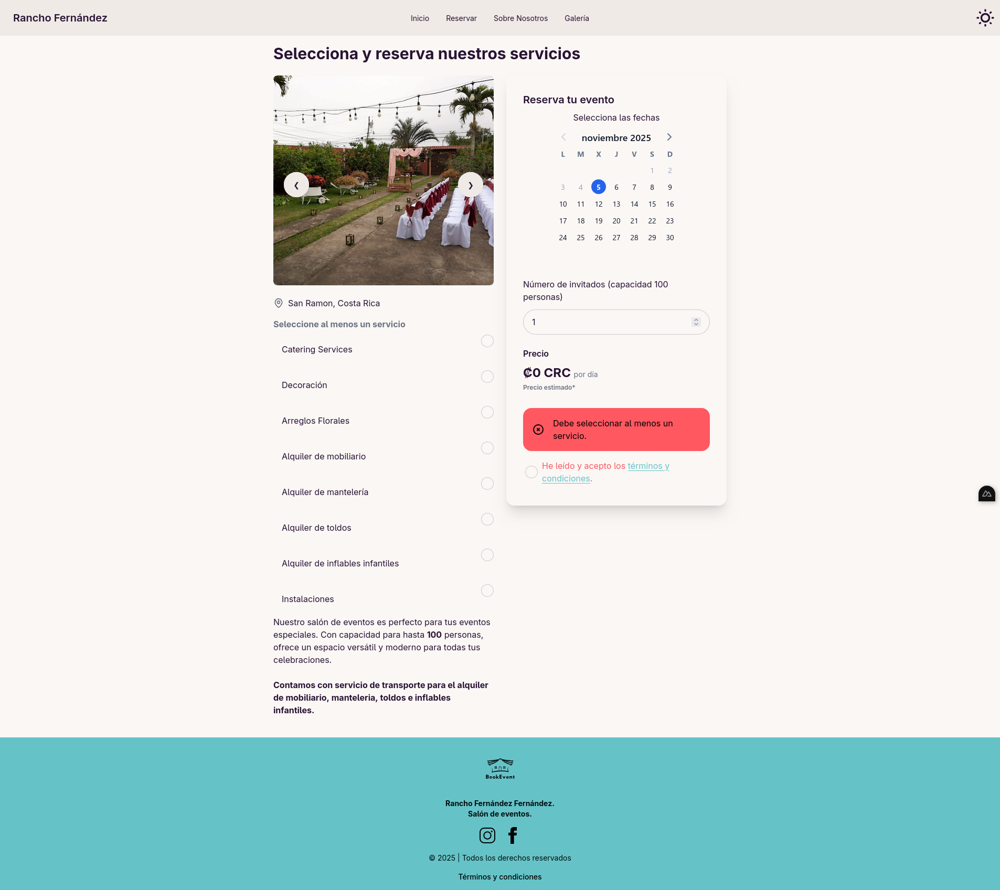
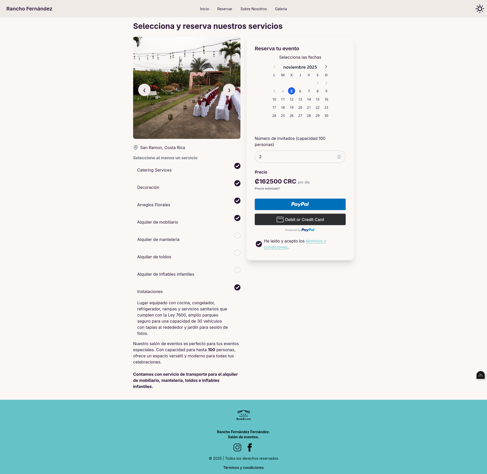
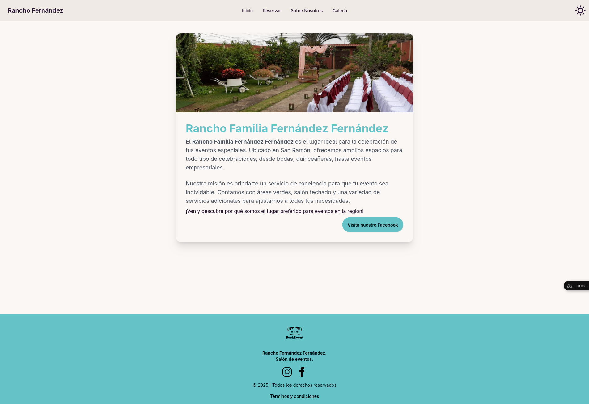

# BookEvent

BookEvent is a web platform that allows users to plan and book personalized events at
Rancho Fernández Fernández. Users can select available dates, customize services, and
complete reservations with integrated payment options — all in one streamlined
portal.

## 🧠 Architecture and Design

The project was built with a focus on scalability, **clean architecture**, and real-time
collaboration between users and the platform.

**Key Practices:**

- Clean Code and SOLID Principles
- Modular, maintainable code structure
- Dependency Injection for flexible component management
- SCRUM methodology for agile development and iterative delivery

## ⚙️ Technologies and Tools

- Frontend: Vue / Nuxt
- Backend as a Service: Supabase (Realtime sync, Auth, and Object Storage)
- Payments Integration: PayPal
- Database: Supabase PostgreSQL
- Email Notifications: Automated confirmation system for user bookings
- Version Control: Git / GitHub
- Project Management: Jira
- Methodology: SCRUM Framework

## 🚀 Project Management

Developed following the SCRUM framework, using Jira for sprint planning, task
tracking, and progress management. Collaboration and communication were key to
ensuring consistent delivery and feature alignment.

## 📱 Features

- Interactive calendar for booking event dates
- Customization of event services (add, remove, or modify)
- PayPal integration for secure online payments
- Supabase Realtime for instant updates across users
- Email confirmation system for user bookings
- Object storage for media and related event assets
- Scalable, maintainable architecture based on best coding practices

## 📷 Images

